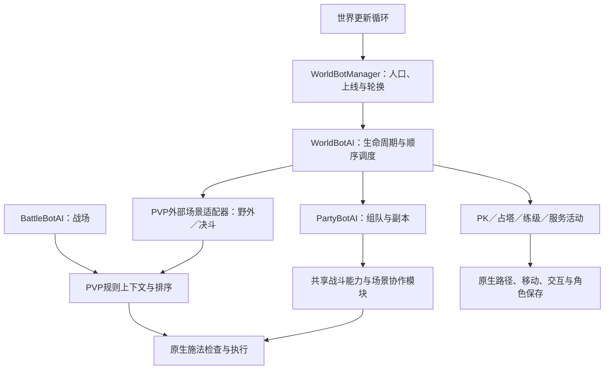

# AI Bot 世界：现状、扩展边界与演进建议

## 结论与审查范围

愿景是一个由 AI Bot 持续生活、人类可以参与的世界。现有实现具备持久角色、人口管理、场景 AI、原生执行和部分数据驱动规则的基础，适合渐进演进；**尚不具备统一世界智能体框架所需的任务生命周期、行动仲裁、外部决策契约和完整评估闭环**。

本次是源码架构审查，基于公开服务端提交 `b3e9549ca617184ed4c8245ab9b590cddec5eafe`。导出来源是原定制工作树 `cef8004268670fb7ceb0b023e5821c2c5c2b4665`，审查时原工作树 HEAD 未变化。没有修改生产行为、运行完整世界仿真或进行规模性能测试。下文“已有”表示查到代码和调用点，不代表每种场景均已实战验收。

当前 AI 是规则与状态机驱动；本次审阅的 PlayerBots 代码中未发现已接入的 MCP／外部模型推理协议或强化学习训练执行链路。热更新策略不等于在线学习。

## 当前实际分层

这里的“外部场景”是相对于 BattleBot 的世界／决斗适配，并非外部 AI 服务。图中分层是现有调用关系的归纳，不是代码中已经存在的统一插件框架。

| 层次 | 当前事实 | 扩展边界 |
| --- | --- | --- |
| 身份与人口 | 世界 Bot 使用可保存的原生角色；Manager 管配额、批次上线、轮换与配置 | 是既有角色池的调度，不等于无限自动创建角色或自主生成角色社会 |
| 世界活动 | 已有 PK 状态机、占塔小队、练级及补给服务流程 | 新任务仍需修改 WorldBotAI／purpose 分支，尚无活动注册和统一生命周期 |
| 场景与协作 | 组队、战场、副本、决斗有各自逻辑；团本协调和站位已拆出模块 | 优先级主要依赖分散的条件与提前返回，模块之间没有统一仲裁器 |
| 战斗策略 | PVP 有 JSON 条件、优先级、分数调整、反应时机和不可变策略快照 | 可配置的是既有字段和施法动作；新增感知字段、动作类型仍需改代码 |
| 执行 | 使用原生技能与移动接口；PVP 规则执行前检查 CD、GCD、资源、控制、LOS 和真实射程 | 原生保护值得保留，但还没有所有活动共同使用的受限命令接口 |
| 记录 | 有角色状态、PK 事件、路径诊断、策略解释和拒绝计数 | 没有统一的观察—候选—决策—执行—结果记录与版本关联 |

### 可核对的源码证据

- [World.cpp:2137](https://github.com/AzerothFoundry/vmangos-core/blob/b3e9549ca617184ed4c8245ab9b590cddec5eafe/src/game/World.cpp#L2137)：世界循环调用 Manager；[WorldBotManager.cpp:200](https://github.com/AzerothFoundry/vmangos-core/blob/b3e9549ca617184ed4c8245ab9b590cddec5eafe/src/game/PlayerBots/WorldBotManager.cpp#L200) 在 map-worker barrier 后逐角色调用 UpdateWorld，再以五秒节拍管理人口与快照。
- [WorldBotAI.h:21](https://github.com/AzerothFoundry/vmangos-core/blob/b3e9549ca617184ed4c8245ab9b590cddec5eafe/src/game/PlayerBots/WorldBotAI.h#L21)：WorldBotAI 继承 PartyBotAI，允许持久保存；[WorldBotAI.cpp:703](https://github.com/AzerothFoundry/vmangos-core/blob/b3e9549ca617184ed4c8245ab9b590cddec5eafe/src/game/PlayerBots/WorldBotAI.cpp#L703) 的实际更新顺序串联了任务和战斗。
- [WorldBotPKTask.cpp:159](https://github.com/AzerothFoundry/vmangos-core/blob/b3e9549ca617184ed4c8245ab9b590cddec5eafe/src/game/PlayerBots/WorldBotPKTask.cpp#L159)：PK 任务有独立状态文件与身份检查；当前到期逻辑继续同一种 PK 任务，不是通用任务选择器。
- [PvPCombatPolicy.h:10](https://github.com/AzerothFoundry/vmangos-core/blob/b3e9549ca617184ed4c8245ab9b590cddec5eafe/src/game/PlayerBots/PvPCombatPolicy.h#L10)：Context／Rule／Snapshot／Rank；[PvPCombatPolicy.cpp:352](https://github.com/AzerothFoundry/vmangos-core/blob/b3e9549ca617184ed4c8245ab9b590cddec5eafe/src/game/PlayerBots/PvPCombatPolicy.cpp#L352) 有重载、轮询和内存修改冲突保护。轮询至多每秒进行一次；Patch 仅允许白名单字段，不是任意脚本执行。
- [BattleBotPolicyRuntime.cpp:601](https://github.com/AzerothFoundry/vmangos-core/blob/b3e9549ca617184ed4c8245ab9b590cddec5eafe/src/game/PlayerBots/BattleBotPolicyRuntime.cpp#L601)：原生合法性检查；[同文件:831](https://github.com/AzerothFoundry/vmangos-core/blob/b3e9549ca617184ed4c8245ab9b590cddec5eafe/src/game/PlayerBots/BattleBotPolicyRuntime.cpp#L831) 按候选尝试执行。80 码是部分感知／候选上限，并受同图、可见／侦测和 LOS 约束；不是 80 码施法或全知视野。
- [PartyBotAI.cpp:1423](https://github.com/AzerothFoundry/vmangos-core/blob/b3e9549ca617184ed4c8245ab9b590cddec5eafe/src/game/PlayerBots/PartyBotAI.cpp#L1423) 串联团本协调、特殊策略、群嘲、服务与站位；职业 PVE 循环仍主要由后续职业 switch 和 C++ 函数实现。
- [BattleBotPolicyRuntime.h:76](https://github.com/AzerothFoundry/vmangos-core/blob/b3e9549ca617184ed4c8245ab9b590cddec5eafe/src/game/PlayerBots/BattleBotPolicyRuntime.h#L76) 明确战斗适配器不负责导航、选敌和场景切换；不能将它当作完整世界决策器。

## 必须直面的缺口

1. **模式枚举不等于模式已贯通。** [WorldBotAI.cpp:741](https://github.com/AzerothFoundry/vmangos-core/blob/b3e9549ca617184ed4c8245ab9b590cddec5eafe/src/game/PlayerBots/WorldBotAI.cpp#L741) 的长期世界角色战场分支仍返回 `battleground_adapter_pending`。不能因为存在 Battleground 枚举，就声明持久世界角色已经能完整切换到 BattleBot。临时战场 Bot 的能力不能直接推定到这条链路。
2. **任务入口仍被主类控制。** 塔与 PK 显式排在主循环中，塔任务通过 friend 访问 WorldBotAI 状态；新增钓鱼、采集或拍卖活动还需要碰主类。bool 返回值也没有统一表达“运行中、让出、阻塞、完成、失败”。
3. **同一角色的动作所有权分散。** 任务、恢复、站位、开旗与战斗可能都想移动、施法或交互。局部保护已存在，但不断叠加 early-return 会增加抢占和饥饿风险；这是一项架构风险判断，不是已复现所有冲突。
4. **持久化与热更语义不统一。** PK 有原子状态保存和定时配置刷新；塔配置初始化加载，任务状态另有快照恢复；部分状态与事件路径仍依赖原 Linux 运维布局。角色保存不代表任意活动都支持重启续接。
5. **还没有外部决策边界。** 协议包队列不是模型命令接口。现有规则会直接读取 Player／Unit／Map；外部推理不得长期持有这些对象，也不能阻塞世界更新线程。
6. **扩展规模未形成预算闭环。** 有局部节拍、队列上限和节流，但未看到统一的每 tick 寻路、决策与日志预算。人口配置允许 2000 人不代表 2000 个复杂行为角色已通过承载测试。

## 建议的演进接口（尚未实现）

无需一次重写既有战斗系统。先用小接口包住现有任务，再逐步替换内部实现。

### 1. 活动生命周期与选择

定义 Activity 的 CanStart／Start／Tick／Suspend／Resume／Cancel，返回显式 Running／Blocked／Completed／Failed；活动持有 ID、版本、期限、暂停原因和可恢复状态。选择器根据等级、阵营、补给、兴趣及可用活动决定下一任务，同等合适选项再随机，并保留一段承诺时间。

先迁移已有 PK，再接入第二条活动（优先复用现有占塔任务）。不要一开始构建包含所有世界玩法的大框架。首次验收目标是：**第二条活动能以模块注册，不修改 WorldBotAI 主循环的条件链。** 添加 C++ 模块仍可能需要编译；不承诺任意新玩法只改 JSON 即可完成。

### 2. 统一行动仲裁

任务、战术与战斗只提出 Intent，由仲裁器分配移动、施法、交互等资源，记录优先级、owner、有效期及取消原因。死亡、传送、真人组队、战斗开始／结束成为明确事件；高优先级打断后，原任务能够解释性恢复。

仲裁应理解目标：保护开旗读条、避免移动取消己方关键施法、允许紧急治疗抢占普通输出。不能将“战斗永远第一”写成所有场景通用的僵硬规则。

### 3. 观察、决策、执行分离

把角色能够合法感知的状态投影成只读 Observation，携带 actor generation、场景版本、地图／副本、目标 GUID 和时间。规则、脚本或未来模型使用同一份契约；输出受限 Intent，禁止直接执行任意 SQL、GM 命令或访问世界对象。

执行仍在服务器安全线程检查目标存活、场景一致、CD、GCD、资源、射程、LOS 和权限。外部推理使用异步请求、deadline、限流和背压；过期响应丢弃，超时自动回退已知规则。模型不直接控制客户端，也不绕过原生规则。

### 4. 行为记录与评估

统一 DecisionEvent，关联任务／场景 ID、观察版本、策略版本、候选与否决理由、选中意图、原生执行结果和最终效果。随机种子可用于可控测试；在线世界的并发与时间差意味着不能仅凭种子承诺完全确定性回放。

先覆盖发呆／无进展、目标抖动、任务响应与打断延迟、支援、开旗、有效治疗／伤害等指标。延迟报告 P50／P95 与样本数，结果按职业、场景、策略版本和对手强度分组。采样、脱敏、轮转和写入预算也是接口的一部分。

角色继续保存到原生数据库；附加任务状态和事件使用版本化文件，不要求修改服务器表结构或引入新数据库。事件记录成熟后，再讨论训练数据、奖励设计和强化学习。

## 建议实施次序与验收

| 顺序 | 范围 | 验收边界 |
| --- | --- | --- |
| 先修能力缺口 | 明确持久角色的战场适配支持范围及回退 | 原生角色进场、退场、死亡、断线与任务恢复均有用例，不能静默挂起 |
| 第一轮结构改进 | Activity 最小契约，迁移 PK 和一条现有活动 | 不改主循环就能接第二活动；中断、恢复、失败与重启状态可测 |
| 第二轮结构改进 | Intent 仲裁、共享观察字段与安全执行门 | 冲突动作仅合法的一方执行，旧目标与过期场景请求被拒绝 |
| 第三轮质量改进 | 统一事件与指标，错峰及预算 | 同策略可比较，样本与开销可解释，不承诺尚未测出的在线人数 |
| 最后探索 | 异步外部模型／MCP／学习策略适配器 | 先 shadow 评估；超时、错误、取消和恶意意图不影响服务器基本运行 |

以上是评估后的建议，并非已实施承诺。本轮仅发布愿景与架构审查，不改变线上 Bot 行为。现有战斗模块和原生执行能力应复用，避免一次性重写。
